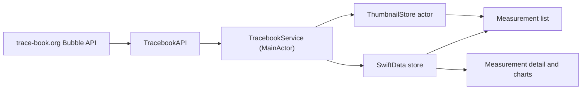

# Tracebook architecture

## Product boundary

Tracebook is a read-only client for public data from trace-book.org. Members upload measurements and website moderators approve them outside the app. The app never modifies website data.

Offline support means reading data that the app has already synchronized. It does not include offline creation, editing, uploads, queues, or conflict resolution.

## Data flow

1. `TracebookAPI` requests public Bubble measurement pages.
2. `TracebookService` inserts or updates `MeasurementItem` records in SwiftData.
3. Existing `MeasurementContent` is preserved unless the API's additional-content reference changes.
4. Missing transfer-function content is downloaded in the background and persisted.
5. Opening a measurement with missing content requests it immediately. Requests for the same measurement share one task.
6. List thumbnails are downsampled and cached as files in Application Support. The thumbnail URL participates in the cache key so changed images replace stale files.

## Isolation and concurrency

- `TracebookService` is main-actor isolated. Its synchronization state and content-task registry are serialized there.
- `TracebookStore` owns one SwiftData `ModelContext`, used through the main-actor service and view model.
- `ThumbnailStore` is an actor. It owns its `NSCache`, file operations, and reset generation.
- Network requests suspend actors rather than blocking them. Thumbnail prefetch permits up to four outstanding requests.
- Chart models are observed by SwiftUI and remain main-actor isolated.

## Reset behavior

The Settings testing utility cancels and awaits tracked synchronization work, removes local measurement/content records, clears memory and disk thumbnails, and refreshes the list. A cache generation prevents a request that began before reset from writing a thumbnail afterward. Website data is never affected.

## Test seams

- `TracebookStore` accepts an in-memory `ModelConfiguration`.
- `BubbleAPI` accepts a `URLSession` for deterministic protocol-backed networking tests.
- `TracebookService` accepts a `TracebookAPIClient` and store.
- `ThumbnailStore` accepts a session and cache directory.

These seams exist to test production behavior without network access or persistent user data. Production initializers retain their default dependencies.
